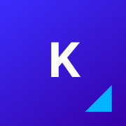
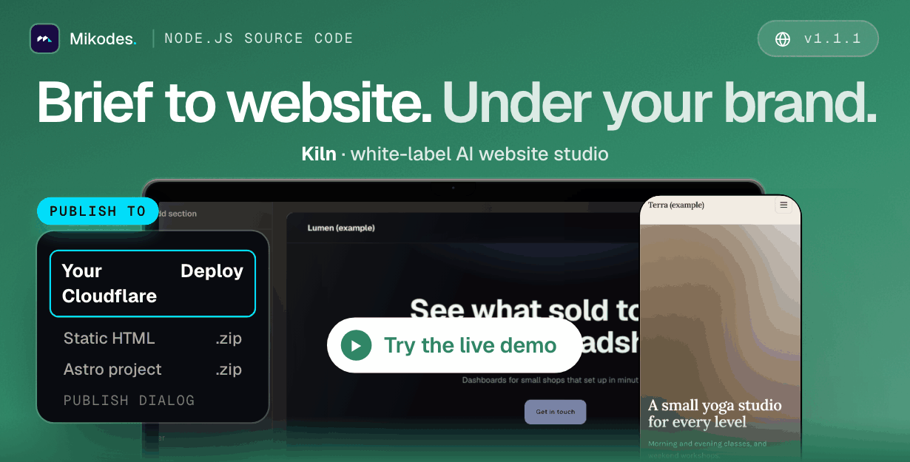
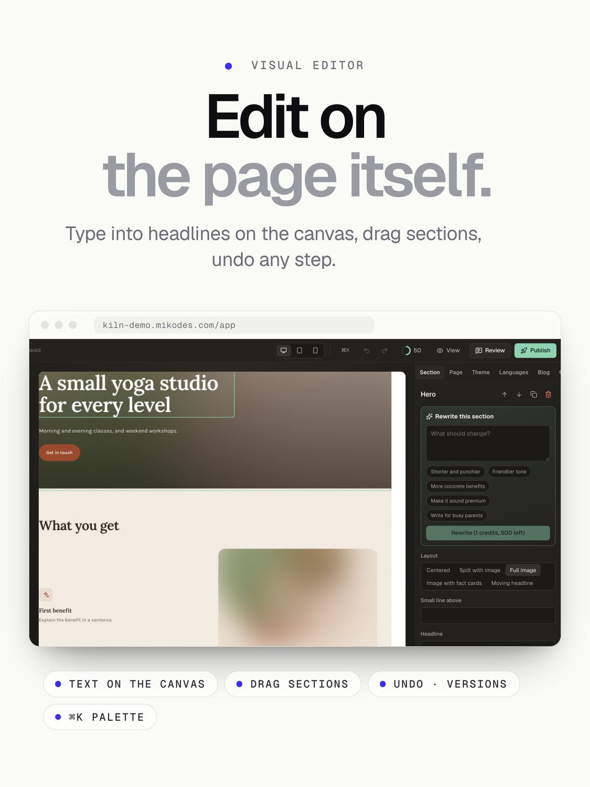
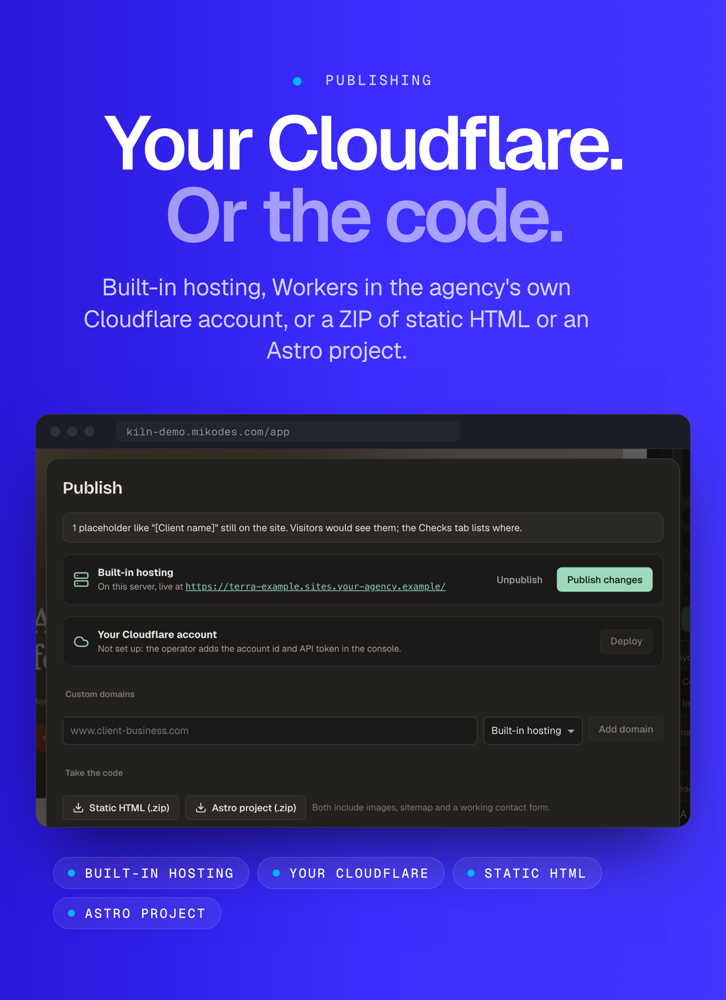
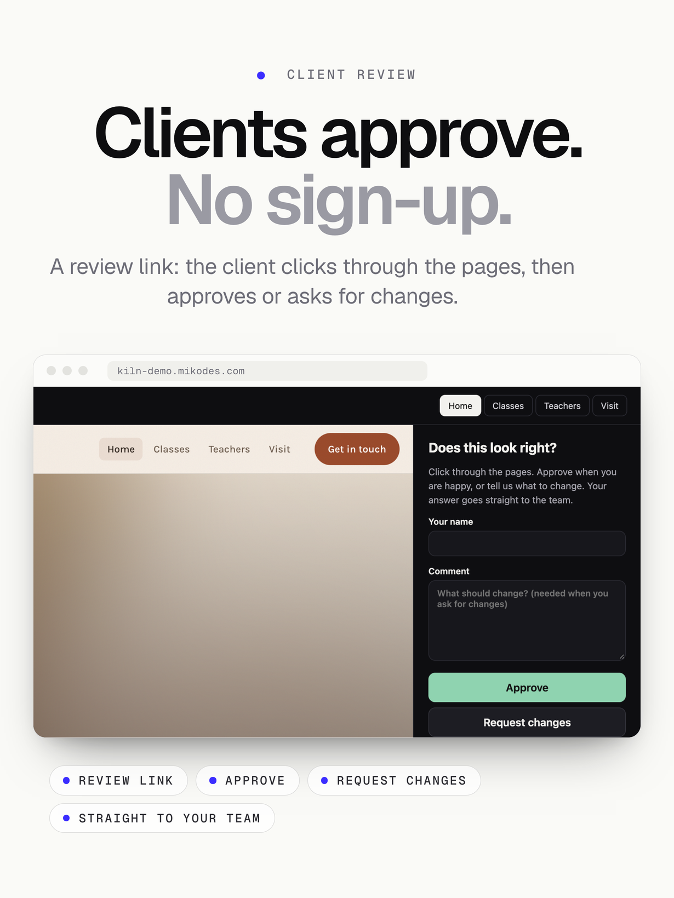
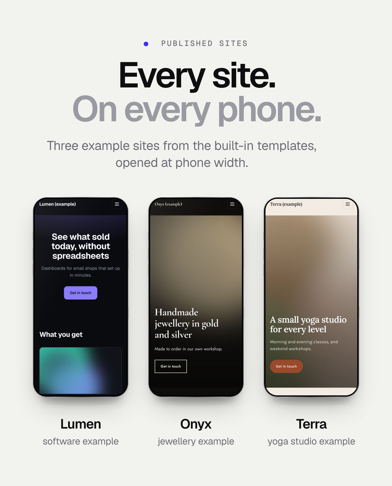

  

<h1 align="center">Kiln</h1>

  <b>White-label AI website builder for agencies (Node.js).</b>

  <a href="https://kiln-demo.mikodes.com/"><b>▶ Live demo</b></a> ·
  <a href="https://store.mikodes.com/p/kiln/"><b>Get the full source code</b></a>

  
  

  

> **This repository is a showcase.** It holds screenshots, documentation pointers and a real excerpt
> from the code. The full application is sold as source code at
> **[store.mikodes.com/p/kiln](https://store.mikodes.com/p/kiln/)**: one payment, instant ZIP download, free setup help.

---

## What it is

A client brief becomes a multi-page website: an editable page plan, then each page written with live progress, a visual canvas editor, client review and one-click publishing.

## Screens

 

 

## Features

- **Brief to multi-page site with AI, in stages**: Brief, editable page plan, then each page written separately with live progress.
- **Draft engine without AI**: Structured draft from the brief, free.
- **Rebuild from an existing website URL**: Reads the client's current public page into the brief.
- **Visual block editor**: Live canvas at real device width, text editing on the canvas, drag sections, floating toolbar, undo/redo, autosave, versions, ⌘K palette.
- **AI section rewrite, AI page chat, AI translation, AI blog drafts**: Every AI change is validated against the section shape and undoable.
- **Bring your own AI key: Claude, OpenAI, OpenRouter, any OpenAI-compatible endpoint**: Default claude-opus-5-5.
- **16 style presets, 16 templates, agency templates**: Agencies save any site as a template for every workspace.
- **Built-in hosting with sites domain and verified custom domains**: Sites live at <site>.<your domain>.
- **Publish to the agency's own Cloudflare account**: Workers static assets via the direct-upload API, workers.dev URL, custom domains in the account's zones. Tested against a mocked API only.
- **Clean code export: static HTML and Astro project**: ZIP with media, sitemap, robots and a working form.
- **Client review links**: Client approves or requests changes without an account.
- **Workspaces with owner, editor, client and viewer roles**: Client role edits texts and images only.

## A look at the code

**Server-side request forgery guard**: [`snippets/ssrf-guard.ts`](snippets/ssrf-guard.ts). Decides whether an address is private, loopback, link-local or tunnelled in any IPv4 or IPv6 spelling, and refuses such addresses before a site is imported from a URL. It keeps the builder from being used to reach an internal network.

## Requirements (full version)

- Node.js 22.12 or newer and npm
- A Linux server or VPS
- Build tools for better-sqlite3 when no prebuilt binary exists
- Own AI provider account and key
- Optional: own Stripe, Cloudflare, Resend and Pexels accounts

Not included: Hosting, server, domain and TLS certificates; AI provider usage; Stripe fees; Cloudflare plan limits above the free tier; Resend plan.

## Get the full source code

  

One payment, full licence, instant ZIP download and free setup help.
Questions: [mikodes.com/support](https://mikodes.com/support).

---

  Made by <a href="https://mikodes.com"><b>MIKODES</b></a> · <a href="https://github.com/Mikodesteam">more projects</a>

