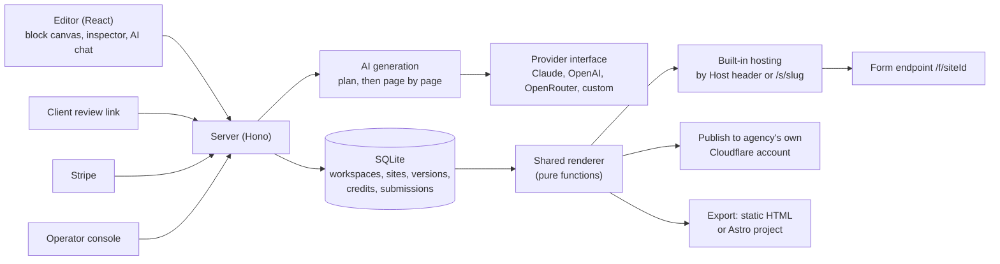

# How Kiln works

A case study of a self-hosted, white-label AI website builder for agencies: a short brief becomes a multi-page
site that clients can review and edit, then it is published, hosted or exported. It is written from the real code;
the excerpts linked below are verbatim pieces of it. The complete application is not in this repository.

## The problem

An agency that builds small-business sites repeats the same work: plan pages, write copy, pick a style, build
sections, get client approval, publish to a domain. Generic AI site generators produce a site in one go that is
hard to edit, may contain invented testimonials and prices, and live on someone else's platform. Kiln's idea is to
treat the AI as a **planner and copywriter inside a structured editor**: the model fills a fixed library of sections,
everything it returns is forced into a known shape, and the agency keeps control of hosting, branding, billing and
the client relationship.

## Architecture

One Node.js server (Hono, SQLite) serves a React editor and dashboard, a public layer (hosting, review links,
form endpoint) and an operator console. The site itself is data (a JSON document of pages and sections); one pure
renderer turns it into HTML, and the same renderer runs in the browser (editor canvas) and on the server (hosting,
export), so what you edit is byte-for-byte what is published.

- `src/shared` is code that runs on both sides: the block library (`blocks.ts`), the model and normalizers, the
  renderer, the escape helpers, the checklist and the draft engine that works without AI.
- `src/server/ai` has the provider adapters and the staged generation functions.
- `src/server/routes` has sites, hosting (public), billing, auth and console routes.
- `src/server/publish` has the Cloudflare uploader and the code exporter.

## One flow end to end: from a brief to a published, multi-page site

1. **Brief.** The agency (or the client) enters the business name, what it does, audience, tone, the facts the copy may
   use and optionally the pages wanted and a style.
2. **Plan (stage one).** The model gets the section catalog (generated from the same definitions the editor uses) and
   returns a sitemap in a strict JSON schema: pages, slugs, a style from the preset list, and for each page a list of
   sections with a type, a variant and a one-line purpose. The result is normalised and truncated to the plan's page
   limit. The person can edit this plan before anything is written.
3. **Generate (stage two).** On approval the server first builds a complete **draft without AI** from the plan, so a
   usable site exists immediately and is saved. Then it streams progress over server-sent events, writing one page at a
   time. For each page the model returns each section's props as a JSON string; a normaliser merges them over the
   section's defaults and forces them into the known field shapes. A page that fails is reported and the others
   continue; running out of credits stops the loop.
4. **Charge and refund.** Each AI call debits credits first (unless the workspace brings its own key), records an
   "open charge" that survives a restart, and refunds if the call fails. After the pages, images are added either
   from a stock source or generated, each charged the same way.
5. **Edit.** The site opens in the editor. A block canvas, an inspector built from the field definitions, per-section AI
   rewrite, an AI chat that answers with *operations* (update, add, remove, theme) that are validated and applied as one
   undo step, translations, and a blog. Saves are versioned with a base-version check.
6. **Check.** The quality checklist runs ([excerpt](../snippets/site-quality-checks.ts)).
7. **Client review.** A review link lets the client look at the site (served in a sandbox, see below) and approve or
   comment. A user with the *client* role may change texts and images but a save that changes the structure (sections,
   layout, design) is refused.
8. **Publish.** Built-in hosting serves the site on `<slug>.<sites domain>` or on a custom domain after the owner
   proves control with a DNS TXT record. Or deploy to the agency's own Cloudflare account, or export a ZIP of static
   HTML or an Astro project with working forms.
9. **After publishing.** Visitors post forms to `/f/<site>`. Submissions land in a forms inbox with CSV export,
   optional e-mail notices and an optional webhook.

## Key engineering decisions

### 1. The model fills a fixed section library, it does not write HTML

*Chosen:* a block library with typed fields; the prompt describes the same fields; `normalizeBlock` forces whatever
comes back (from the AI, an import or an old save) into that shape. Nothing the model returns is rendered unless it
fits a known section. *Alternative:* ask for HTML or a free layout. *Why:* a structured site stays editable by a
non-technical client, can be translated and re-styled, and a model mistake becomes a missing field, not broken markup
or an injected script.

### 2. Two-stage generation with a deterministic draft in between

*Chosen:* plan, then a draft built by code, then the AI replaces the draft's content page by page. *Alternative:* one
big prompt for the whole site. *Why:* small requests with small schemas are more reliable and cheaper to repair;
the person sees and can change the plan before money is spent on copy; and if the AI fails halfway the site is still
a coherent draft, not a half-written one.

### 3. Never invent facts; use visible placeholders instead

*Chosen:* the copy rules forbid invented testimonials, names, prices, statistics, years, awards or contact details and
tell the model to write a bracketed placeholder where a fact is missing; the editor's checklist reports any leftover
placeholder as an error. *Alternative:* let the model fill the gap with plausible text. *Why:* an invented client quote
on a client's website is a legal and trust problem. A visible hole is honest and easy to fix.

### 4. One pure renderer on both sides

*Chosen:* rendering is pure string code in `shared/`, used by the editor canvas, the server preview, hosting and the
exporter. *Alternative:* a separate preview and a separate export. *Why:* "what you see is what is published" becomes a
property of the code, and the export has no lock-in because it is the same output.

### 5. Provider interface, bring your own key

*Chosen:* a minimal interface (system prompt, user prompt, JSON schema in; parsed JSON, token counts and model name
out), with a Claude adapter using structured outputs, OpenAI and OpenRouter adapters, and a custom
OpenAI-compatible adapter. The agency's keys are stored in the operator console. *Alternative:* hard-wire one model.
*Why:* prices and quality change; an agency should switch without a code change, and charging credits per action
(or zero when the workspace brings its own key) makes the economics visible.

## Security and safety measures that exist in the code

- **Output escaping.** Everything a user or the AI wrote is HTML-escaped when rendered; rich text passes a small tag
  allow-list; links pass a protocol allow-list (`javascript:`, `data:`, `vbscript:` and protocol-relative links
  become `#`); image sources must be http(s), site-relative or a raster data URL, and SVG data URLs are refused.
- **Sandboxed previews.** Site pages served on the builder's own address (previews, review links, thumbnails) carry a
  strict Content-Security-Policy with the `sandbox` directive and without `allow-same-origin`, so the page is an opaque
  origin ([excerpt](../snippets/sandboxed-preview-csp.ts)). Tag managers, analytics, pixels and custom head code are not
  rendered there at all. The published site on its own domain is a different origin.
- **SSRF protection** for "Rebuild from a website URL" and for form webhooks ([excerpt](../snippets/ssrf-guard.ts)):
  every redirect hop is resolved and refused if it points into a private, loopback or link-local network, with caps on
  hops, bytes and time.
- **Domain ownership.** A custom domain is served only after a DNS TXT record proves control.
- **Public form endpoint.** Per-site and per-IP rate limit, a hidden honeypot field, a strict field-name pattern, size
  limits counted as bytes stream in (so a chunked request cannot exceed them), a valid e-mail required, and
  fire-and-forget webhooks that never block the visitor. The IP is stored only as a hash.
- **Roles.** Owner, editor, client and viewer; the client role cannot change a site's structure (checked by comparing a
  "skeleton" of the document before and after).
- **Stripe webhook** signature is verified (HMAC with a timestamp) before anything is trusted; money lands in the
  operator's own Stripe account.
- **Request size limits** that hold whatever the client claims in `Content-Length`.
- **Read-only demo mode** refuses writes, so a public demo cannot be used to store data.

## How you would build something like this

1. **Start with the section library as data.** Types, variants, fields with types and limits, and defaults. Generate the
   editor forms, the AI prompt and the validators from this one source.
2. **Write the renderer as pure functions** from a site document to files, with escaping built in. Test it with
   snapshots. Use it for preview and export from day one.
3. **Build the draft engine without AI.** It forces you to define what a "good enough" site is, and it is your fallback.
4. **Add a provider interface and one adapter.** Ask for JSON with a schema, normalise every answer, and never let a
   model answer reach the renderer unvalidated.
5. **Stage the generation:** plan, review, then copy by page. Stream progress. Make each stage cheap to repair or retry.
6. **Put money logic around AI calls early:** debit before, record the open charge, refund on failure, and log usage.
7. **Add the editor** with versioned saves and a role model, then review links and the client role.
8. **Publishing last:** hosting by Host header, domain verification, then export and one external target.
9. **Treat the public edges as hostile:** form endpoint, importer, previews. Sandbox what you serve on your own origin.

## Deployment and customization

Kiln is a Node.js server with a SQLite database and a React front end, shipped with a Dockerfile. The operator console
(built on the MIKODES Admin Kit) holds branding and white-label settings, the AI provider keys, hosting and sites
domain, Stripe, plans, credit costs and packs, e-mail, team and an audit log. You can change the section library and
its variants, the style presets and templates (16 of each ship), the prompts and copy rules, the plans and credit
prices, and the hosting and export targets.

Full source code, docs and setup help: https://store.mikodes.com/p/kiln/
